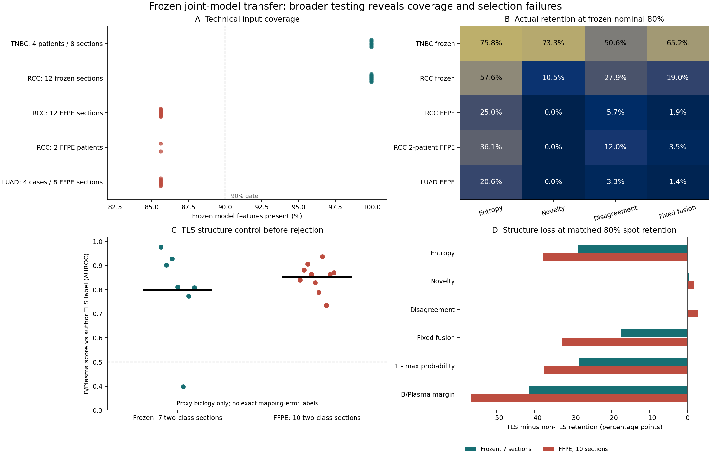

# Frozen Cross-Dataset Expansion

Completed: 42 sections, 125,430 spots, four additional source studies. No training
or threshold adaptation. These cancer categories were represented in training;
the new axis is source study and spatial measurement preparation.

Read [REPORT.txt](REPORT.txt), [original protocol](PROTOCOL.txt), and the
[source-metadata correction](METADATA_CORRECTION.txt) together. The results are
negative for universal threshold transfer, not evidence of universal mapping
accuracy. Feature-limited FFPE results are diagnostic only. Author TLS labels
are a structure-preservation control, not mapping-error truth.



## Source Accounting

| Source | Cancer | Local sections | Verified within-source identity |
| --- | --- | ---: | --- |
| GSE210616 | TNBC | 8 of 43 source records | 4 patients |
| GSE300676 | LUAD | 8 | 4 source cases |
| GSE175540 | RCC | 24 | Unresolved; section summaries only |
| GSE210041 | RCC | 2 | 2 patients; descriptive only |

The earlier 14-section audit used two other source studies. Combined, this
frozen-model audit has 56 sections, 165,287 spots and six source studies. Do not
count the preceding candidate inspection as another set of model tests.
Cross-study patient aliases and legacy data exposure remain limitations.

## Reproduce the Aggregate Report

The published tables are sufficient to regenerate the summary and figure:

```bash
python -B work/singlecell_spatial_benchmark/scripts/report_cross_dataset_joint_v1.py \
  --run studies/cross_dataset_joint_20261107
```

No patient matrices or model weights are needed for this aggregate-only step.
SVG text is editable. Figure D compares TLS and non-TLS retention at matched
80% total retention; near-neutral FFPE novelty selection is a barcode tie break
because its clipped score is constant, not a successful regional risk detector.

## Re-run Inference

Inference requires the local source matrices, the original joint-training
prepared artifacts and the frozen three-member checkpoint set. They are not
included in this repository. The hashes are supplied in
`run_provenance_public.json`; public code alone is not a one-command replication
of fitted-model inference. Follow source data access conditions.

```bash
python -B work/singlecell_spatial_benchmark/scripts/validate_cross_dataset_joint_v1.py \
  --data-root /path/to/UNIST_data \
  --lung-dir /path/to/gse300676_lung \
  --out /path/to/healthy-volume/new-run \
  --device cuda
```

The local recovery runner refuses output on the D: volume because that input
disk reported filesystem errors during this run. It never modifies input data.
The corrected discovery code reads GSE210041 patient IDs from source
characteristics and assigns FFPE. `correct_cross_dataset_metadata_v1.py` records
the original historical inventory correction without changing predictions;
it is not a fitting step. The original protocol is preserved as a historical
record, with the separate correction superseding its two-sample identity note.

Tests:

```bash
python -B -m pytest -p no:cacheprovider tests \
  work/singlecell_spatial_benchmark/scripts/test_joint_training_v1.py \
  work/singlecell_spatial_benchmark/scripts/test_frozen_joint_spatial_v1.py \
  work/singlecell_spatial_benchmark/scripts/test_cross_dataset_joint_v1.py -q
```

## Public Export

Only code, protocol, source hashes, section/cohort aggregates and figures are
included. No raw matrices, clinical source tables, per-spot predictions, model
weights, credentials or manuscript drafts are uploaded. `EXPORT_MANIFEST.json`
records hashes of the exported run outputs. Re-rendered SVG/PNG files can have
different serialization metadata without changing the scientific values.
