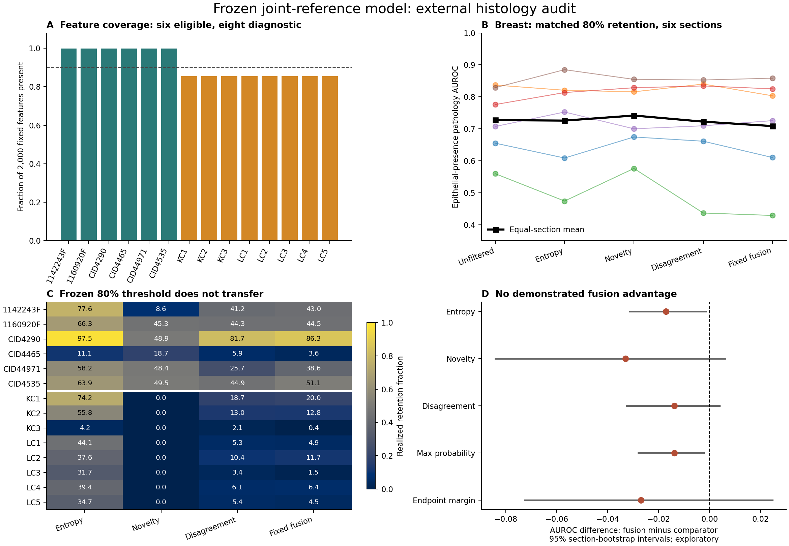

# Frozen Joint-Reference Spatial Audit

This directory contains aggregate results from the frozen joint-reference
ensemble, not the earlier PDAC-reference spatial models. No neural training,
score-weight adjustment or calibration on these external sections was performed.

## Scope and Results

- Two public source cohorts, 14 sections and 39,857 query spots.
- Wu breast Visium: six sections, 15,611 spots, 99.9% model-feature coverage.
- Zurich kidney/lung TLS Visium: eight sections, 24,246 spots, 85.55% feature
  coverage. Below the predeclared 90% technical gate, these are diagnostics only.
- At matched 80% breast retention, equal-section pathology AUROC was 0.7085 for
  fixed fusion, 0.7257 for entropy and 0.7415 for novelty. Unfiltered: 0.7273.
- The original nominal-80% fusion threshold retained a mean 44.5% in breast.
- These findings do not establish an incremental benefit of fixed fusion.

AUROC here measures agreement with an epithelial-presence pathology endpoint.
It is not exact deconvolution error. Histology complexity and TLS are not labelled
mapping errors. Bootstrap intervals use sections, not spots. There are only six
coverage-eligible sections; paired sensitivity tests are exploratory. Study
provenance differs from training, but cross-study patient aliases are unresolved.
The cohorts were previously examined with legacy models and are not a new
prospective blinded holdout. See [REPORT.txt](REPORT.txt) and
[PROTOCOL.txt](PROTOCOL.txt) for exclusions, failures and limitations.



## Sources

- https://zenodo.org/records/4739739
- https://zenodo.org/records/14620362
- Training provenance: `configs/joint_sources_locked.json` and the joint study
  scripts under `work/singlecell_spatial_benchmark/scripts`.

## Reproduction

The public scripts add configurable paths to the analysis used for these
results. Score definitions, model inference, endpoint definitions and statistics
are unchanged. Published tables are not regenerated by package installation.

Required inputs are NOT included in Git: the three frozen joint checkpoints,
their integrity manifest, training features/centroids, frozen calibration,
prepared expression/cell manifests for the replay check, original training
gene metadata, and the two source datasets. The earlier joint-reference scripts
can generate the model inputs; exact reproduction requires the archived versions
and matching checkpoint hashes. A code release alone is not an archive of fitted
models or a complete data backup.

Expected directories under `DATA_ROOT`:

```text
joint_training_v1/
  prepared/
  raw/breast_tnbc.h5ad
  runs/joint_mlp_ensemble_v1/
breast_pathology_zenodo4739739/
  metadata/
  filtered_count_matrices/
pathology_gold_zenodo14620362_tls_visium_usz/
  extracted/TLS_VISIUM_USZ/
```

Use a healthy filesystem and keep results outside the input data directory.
Do not reuse an existing locked output directory.

```bash
pip install -e ".[dev,study]"
python -B work/singlecell_spatial_benchmark/scripts/test_frozen_joint_spatial_v1.py
python -B work/singlecell_spatial_benchmark/scripts/validate_frozen_joint_spatial_v1.py --data-root DATA_ROOT --out RESULTS_DIR --device cuda
python -B work/singlecell_spatial_benchmark/scripts/audit_spatial_normalization_mass_v1.py --data-root DATA_ROOT --out RESULTS_DIR
python -B work/singlecell_spatial_benchmark/scripts/report_frozen_joint_spatial_v1.py --out RESULTS_DIR
```

The default data location may also be set with `UNIST_DATA_ROOT`. A CPU run is
supported for inference (`--device cpu`), although floating-point differences
must still pass the original prediction replay tolerance.

## Data Minimization

Only aggregate section-level results, protocols, summary figures and code are
published here. No expression matrices, per-spot predictions, clinical tables,
patient images, model weights, manuscript drafts or account credentials were
uploaded. The original submission release tag remains unchanged.

The 14 sections should remain an observed failure/transport audit. Do not tune
on these endpoints and subsequently describe them as independent validation.
