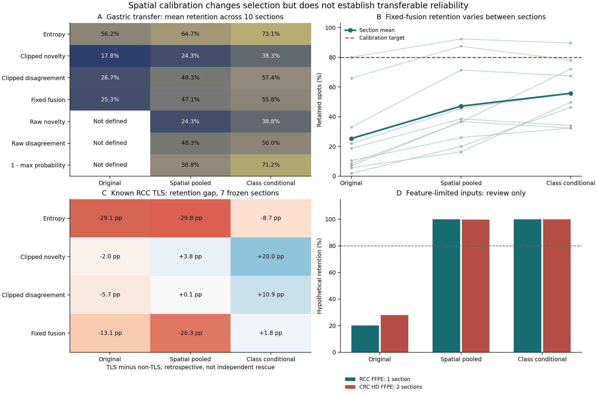

# Spatial Policy Transfer

Calibration is complete and the locked policies have been tested on 13 further
sections from three sources. Neural weights were not trained or adapted.

- Calibration: GSE210616 TNBC, four patients / eight frozen sections;
  GSE300676 LUAD, four source cases / eight FFPE sections.
- New frozen-model test: ten gastric, one RCC and two CRC HD sections,
  1,123,475 nonzero-common-count spatial spots/bins.
- Secondary diagnostic: the previously observed GSE175540 TLS cohort.
  This is retrospective and is not independent rescue validation.

Read [REPORT.txt](REPORT.txt) and the [locked protocol](PROTOCOL.txt).



The result is not a demonstration of robust risk calibration. Gastric retention
remains below target and feature-limited FFPE queries nearly all pass hypothetical
recalibrated thresholds. Those inputs remain review-only. Class conditioning
changes TLS selection in the known RCC data; independent manual-label validation
is still needed. No error AUROC, patient-level significance or clinical benefit
is claimed for the new sources. Hash-random selection is a null control.

## Reproduce Aggregates

```bash
python -B work/singlecell_spatial_benchmark/scripts/report_spatial_policy_transfer_v1.py \
  --run studies/spatial_policy_transfer_20261107
```

The tables suffice to regenerate the report and figure; no raw patient matrices
or mapper weights are needed. SVG labels are editable text. Table roles keep
in-sample calibration, new-source tests and retrospective TLS diagnostics separate.

## Re-run Inference

The original input matrices, frozen model artifacts and preceding calibration
prediction files are required and are not included in this repository:

```bash
python -B work/singlecell_spatial_benchmark/scripts/run_spatial_policy_transfer_v1.py \
  --data-root /path/to/UNIST_data \
  --previous-run /path/to/cross_dataset_joint_20261107 \
  --out /path/to/healthy-volume/new-policy-run \
  --device cuda
```

The local recovery guard forbids writing to D: because that input disk reported
filesystem errors. Original data, earlier results and submitted manuscripts are
untouched. Chunked H5 inference avoids a dense whole-slide matrix; no new per-spot
files are published. Checkpoints and calibration input hashes are in provenance.

Two large CRC sections originally failed at path-name progress logging. The
reader now normalizes string paths to Path objects. `--resume-failed` applies
the already-fitted policies to failed items without refitting or rerunning
completed sections. The original failure artifacts are preserved locally and
the technical recovery is documented in `resume_record.json`.

## Counting and Exposure

The frozen mapper has cumulatively seen 69 sections from nine sources across
these audit rounds. Sixteen now serve as policy calibration; 24 old RCC sections
are reused for diagnostics. Neither is an additional independent test cohort.
All sources have historical legacy-model exposure. Cross-source patient aliases
remain unresolved; the million CRC bins come from only two sections.

This experiment implements empirical coverage policies, not conformal prediction,
calibrated mapping-error probabilities or a new neural architecture. All scores,
including simple entropy and raw novelty, receive identical calibration options.
The 37-test suite includes patient-balanced weights, quantile tie behavior,
fallback support and streaming 50,001 spots through a string-path H5 input.
